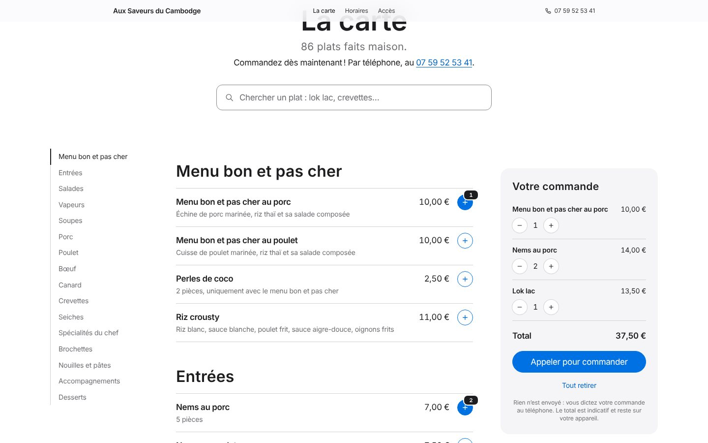
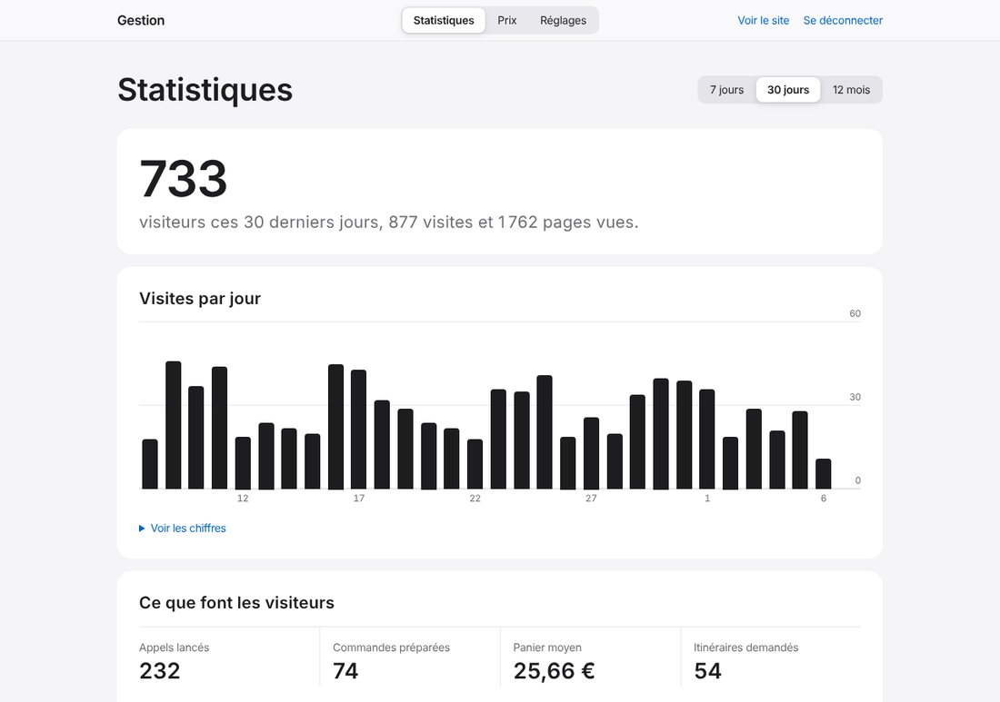

# Aux Saveurs du Cambodge — nouveau site

Refonte complète du site [auxsaveursducambodge-saintalban.com](https://www.auxsaveursducambodge-saintalban.com),
restaurant cambodgien du 10 avenue Salvador Allende, à Saint-Alban.

Version actuelle : **minimaliste, à la manière d'apple.com** (demande du 3 novembre 2026), rendue plus vivante le 6 novembre,
avec un **espace gestion** pour changer les prix et suivre les visites. La première refonte, l'« étal de marché » coloré,
reste disponible dans l'historique git (commit `ba701ed`).


| Mobile | La carte |
|---|---|
|  |  |

| La soupe se prépare au fil du défilement | Espace gestion (chiffres fictifs d'exemple) |
|---|---|
|  |  |

Page d'accueil entière : [apercus/accueil-page-entiere.jpg](apercus/accueil-page-entiere.jpg).

## Ce qui change

| Avant (Squarespace) | Maintenant |
|---|---|
| Fond gris, aucune image, aucune identité | Des tuiles noires et gris perle comme sur apple.com : chaque plat présenté comme un produit, dessiné vu du dessus, une seule police (celle d'Apple sur iPhone et Mac), un seul bleu pour agir |
| Bouton « Cammandez dès maintenant » qui renvoyait vers l'accueil | Bouton **Appeler** dans chaque tuile, téléphone toujours présent dans la navigation, barre « Votre commande · Appeler » en bas de la carte sur mobile |
| Horaires en texte brut, avec fautes | **État ouvert/fermé en direct** (heure de Paris) dans le bandeau sous la navigation, horaires en tableau avec le jour courant mis en avant |
| Carte à l'adresse `/nouvelle-page`, 35 répétitions de la mention riz, prix « €7,5 € » | Carte à `/carte/` (l'ancienne adresse redirige), recherche instantanée, rubriques dans une barre collante, prix au format « 7,50 € » alignés |
| — | **Votre commande** : on ajoute ses plats, on choisit sous chacun le riz nature ou le riz cantonais en supplément (en bordeaux), on voit le total, on appelle et on la dicte |
| Prix modifiables seulement en refaisant le site | **Espace gestion** (`/admin/`) : on change un prix, l'accueil, la carte et les informations lues par Google suivent aussitôt |
| — | **Statistiques** dans l'espace gestion : visiteurs, appels lancés, commandes préparées et panier moyen, plats ajoutés, recherches sur la carte, provenance, appareils |
| Formulaire « Vous avez envie de travailler avec nous ? » (texte de modèle) | Adresse, plan du quartier redessiné d'après l'IGN, liens Itinéraire / Waze / Plans |
| Pas de description, pas de données pour Google | Titre et description, image de partage, données structurées `Restaurant` et `Menu` (horaires, adresse, prix), sitemap |
| — | Accessible (0 erreur axe-core sur toutes les pages, espace gestion compris), mentions légales complètes ; aucune police à télécharger sur les appareils Apple, 75 Ko (Inter) ailleurs |
| Aucune animation | Le nom se lève mot après mot, le bol se pose et fume ; **la soupe se prépare sous les yeux** pendant qu'on fait défiler (bouillon, nouilles, porc, crevettes, herbes, citron vert, baguettes) au rythme de « Tout est fait maison. Avec des produits frais. Et beaucoup d'amour. » ; les plats s'inclinent sous la souris, « ouvert » et l'épingle du plan battent doucement ; sur la carte, les plats arrivent à la file, le « + » fait une onde, le total défile. Avec le réglage « réduire les animations » de l'appareil, les mouvements deviennent des fondus |

Toutes les coquilles corrigées et les points à confirmer sont listés dans [CORRECTIONS.md](CORRECTIONS.md).

## Avant la mise en ligne

1. **Créer le mot de passe de l'espace gestion juste après l'envoi des fichiers** : ouvrir `https://www.auxsaveursducambodge-saintalban.com/admin/`.
   Tant qu'aucun mot de passe n'existe, la première personne qui ouvre cette adresse le choisit : ne pas attendre.
2. **Vérifier la carte** : les points du tableau « À faire vérifier » de [CORRECTIONS.md](CORRECTIONS.md), notamment les brochettes de crevettes affichées à deux prix.
3. **Photos** : les plats du site sont des dessins, signalés comme tels. De vraies photos prises du dessus sur fond neutre les remplaceraient directement (`public/assets/img/plats/`, un fichier par plat).
4. **Service sur place** : le site dit « Commandes et réservations par téléphone ». À corriger si le restaurant ne fait que de la vente à emporter.

## L'espace gestion

À l'adresse `/admin/` du site (le lien « Espace gestion », en bas de chaque page, y mène), protégé par le mot de passe choisi à la première visite (enregistré chiffré, jamais en clair ;
cinq essais ratés bloquent 15 minutes).

- **Carte** : tous les plats, rubrique par rubrique, avec une recherche. Pour chaque plat, son prix et sa description ;
  pour chaque rubrique, son nom. On tape « 10,50 » ou « 10.5 », on change un texte, on enregistre : l'accueil, la carte,
  la recherche de la carte, le total de « Votre commande » et les données structurées pour Google suivent aussitôt.
  Sous ce qui a changé, l'original reste rappelé, avec un bouton « Rétablir ». Une description vidée disparaît de la carte ;
  un nom de rubrique ne peut pas être vide (descriptions : 300 caractères au plus, noms : 60).
- **Statistiques** sur 7 jours, 30 jours ou 12 mois : visiteurs, visites et pages vues, visites par jour, appels lancés,
  commandes préparées et panier moyen, itinéraires demandés, plats ajoutés à la commande, recherches sur la carte,
  provenance (Google, Facebook, accès direct…) et appareils. Les visites de la personne connectée ne sont pas comptées.
- **Réglages** : couper ou rétablir la mesure d'audience, effacer toutes les statistiques, changer le mot de passe.

**Mot de passe oublié** : supprimer le fichier `donnees/config.php` sur le serveur (par SFTP, comme pour l'envoi du site),
puis rouvrir aussitôt `/admin/` pour en choisir un nouveau. Les prix, les textes changés et les statistiques restent ; la mesure d'audience
redevient active si elle avait été coupée.

### La mesure d'audience et les cookies

Le site compte ses visites lui-même, sans Google Analytics ni aucun service extérieur. Il pose un cookie « asdc_mesure »,
valable 13 mois et jamais prolongé ; les chiffres sont gardés 25 mois puis effacés automatiquement ; aucune adresse IP n'est
enregistrée, et l'identifiant du cookie n'est conservé que sous forme d'empreinte illisible. Ce sont les conditions de la CNIL pour une mesure d'audience **exemptée de
consentement** : pas de bandeau cookies. Chacun peut refuser depuis les mentions légales (bouton « Refuser la mesure
d'audience »), et un navigateur réglé sur « Do Not Track » ou « Global Privacy Control » n'est jamais compté, pas plus que les robots.

## Modifier le site

Les prix se changent dans l'espace gestion. Le reste du contenu vient de deux fichiers :

- `data/restaurant.json` : nom, téléphone, adresse, horaires, fermetures exceptionnelles, mentions légales ;
- `data/carte.json` : rubriques, plats, descriptions et prix d'origine ; les plats de l'accueil ont en plus une image (`"image"`) et une phrase (`"accroche"`).

Les quatre plats de la grille de l'accueil sont choisis par leur nom dans `build.mjs` (fonction `accueil`).

Puis, avec Node.js 18 ou plus récent, sans rien installer :

```sh
node build.mjs                       # régénère public/ et l'archive livraison/aux-saveurs-du-cambodge-site.zip
php -S localhost:8000 -t public      # aperçu sur http://localhost:8000 (PHP 7.4 ou plus récent)
```

Fermeture exceptionnelle (le bandeau d'état l'affichera) :

```json
"closures": [{ "from": "2026-12-24", "to": "2027-01-02", "label": "congés de fin d'année" }]
```

## Mettre en ligne

Le site complet tient dans un seul fichier : **`livraison/aux-saveurs-du-cambodge-site.zip`** (300 Ko environ),
refait à chaque `node build.mjs`. Il a besoin d'un hébergement avec **PHP 7.4 ou plus récent** (c'est le cas d'IONOS,
d'OVH, d'o2switch et de XAMPP) ; aucune base de données.

### Chez IONOS (ou tout hébergement Apache avec PHP)

1. **Décompresser l'archive sur l'ordinateur.** On obtient `index.php`, `404.html`, les dossiers `admin`, `assets`, `carte`,
   `donnees`, `inc`, `mentions-legales`, `nouvelle-page`, `stats`, et un fichier caché **`.htaccess`** (sur Mac, Cmd + Maj + point pour l'afficher).
2. **Récupérer les accès SFTP** : espace client IONOS → Menu → Hébergement → tuile « SFTP & SSH » → Gérer → le nom
   d'utilisateur. On y trouve l'hôte (`access…webspace-data.io`), l'utilisateur et le mot de passe ; port 22.
3. **Envoyer les fichiers** avec [FileZilla](https://filezilla-project.org) (gratuit, protocole SFTP) : glisser **le contenu**
   du dossier décompressé, `.htaccess` compris, dans le dossier du webspace prévu pour le site. Remplacer les fichiers existants.
   S'il reste un ancien `index.html` à la racine du site, le supprimer : c'est `index.php` qui doit s'afficher.
4. **Rattacher le domaine à ce dossier** : Domaines & SSL → le domaine → connexion au webspace → choisir le dossier.
   Si le domaine est encore chez Squarespace, le transférer chez IONOS ou faire pointer ses DNS vers IONOS
   (IONOS propose de faire les réglages DNS lui-même quand il gère le domaine).
5. **Vérifier que le certificat SSL du domaine est actif** (inclus dans les offres d'hébergement IONOS) :
   `.htaccess` renvoie tout le monde vers `https://www.auxsaveursducambodge-saintalban.com`.
6. **Ouvrir `/admin/` et créer le mot de passe.**

Les prix saisis, les statistiques et le mot de passe vivent dans le dossier `donnees/` du serveur. L'archive n'en contient
jamais : une mise à jour du site déposée par-dessus ne les efface pas. Le serveur doit pouvoir écrire dans ce dossier
(c'est le cas par défaut chez IONOS ; sinon l'espace gestion le signale).

Ce que fait `.htaccess` : page 404 du site, ancienne adresse `/nouvelle-page` → `/carte/`, fichiers internes (`inc/`, `donnees/`)
jamais servis, passage en HTTPS avec « www » (seulement sur le domaine du restaurant), compression, cache et en-têtes de sécurité.
L'archive a été essayée sur Apache 2.4 avec PHP 8.3, réglé comme un hébergement mutualisé.
En cas de page blanche « erreur 500 » ou d'erreur de certificat, supprimer `.htaccess` sur le serveur remet le site en ligne sans ces réglages.

Si le site change de domaine, mettre la nouvelle adresse dans `url` de `data/restaurant.json` puis relancer `node build.mjs` :
les liens, le plan du site et `.htaccess` suivent.

### Essayer sur son ordinateur avec XAMPP

XAMPP contient Apache et PHP, comme chez IONOS : le site, son `.htaccess` et l'espace gestion y fonctionnent tels quels.
(Ouvrir un fichier par un double-clic ne suffit pas : il faut passer par le serveur.)

1. Dans le dossier de XAMPP (`C:\xampp` sous Windows, `/Applications/XAMPP` sur Mac, `/opt/lampp` sous Linux),
   renommer `htdocs` en `htdocs-xampp` (son tableau de bord est mis de côté), puis créer un nouveau dossier `htdocs` vide.
2. Décompresser l'archive dans ce nouveau `htdocs` : `index.php` doit se trouver directement dedans.
3. Démarrer Apache dans le panneau de contrôle de XAMPP, puis ouvrir <http://localhost/> et <http://localhost/admin/>.

Pour revenir à XAMPP d'origine : supprimer ce `htdocs` et renommer `htdocs-xampp` en `htdocs`.
Variante sans rien renommer : décompresser dans `htdocs/saveurs` et ouvrir <http://localhost/saveurs/>. Tout fonctionne,
sauf la page « introuvable » du site et l'ancienne adresse `/nouvelle-page`, qui visent la racine du serveur.
Si Apache refuse de démarrer, le port 80 est souvent occupé (Skype, IIS) : dans XAMPP, Config → `httpd.conf`,
remplacer `Listen 80` par `Listen 8080`, redémarrer Apache et ouvrir <http://localhost:8080/>.
Sous Linux, donner au serveur le droit d'écrire dans `htdocs/donnees` (`sudo chown -R daemon htdocs/donnees`).

Les hébergements sans PHP (Netlify, Cloudflare Pages, GitHub Pages) ne conviennent plus : ils ne peuvent ni changer les prix ni compter les visites.

### Si les animations ne bougent pas

1. **L'adresse du site montre encore l'ancien site** tant que les fichiers ne sont pas chez IONOS et que le domaine n'y est pas rattaché.
   Pour voir le nouveau dès maintenant : XAMPP, ci-dessus.
2. **L'appareil demande de réduire les animations.** Le site le respecte : rien ne glisse ni ne tourne, tout apparaît en fondu.
   Pour voir les mouvements complets, désactiver ce réglage :
   - Windows 11 : Paramètres → Accessibilité → Effets visuels → activer « Effets d'animation » ;
   - Mac : Réglages Système → Accessibilité → Affichage → décocher « Réduire les animations » ;
   - iPhone : Réglages → Accessibilité → Mouvement → désactiver « Réduire les animations » ;
   - Android : Paramètres → Accessibilité → désactiver « Supprimer les animations ».
3. **Le fichier a été ouvert par un double-clic** : il faut passer par le serveur (IONOS, ou `http://localhost/` avec XAMPP).

Le plat de chaque tuile tourne pendant le défilement dans tous les navigateurs récents (Chrome, Edge, Safari, Firefox).
Sur ordinateur, il s'incline aussi sous la souris.

## Organisation

```
aux-saveurs-du-cambodge/
├── build.mjs              générateur, sans dépendance : pages, carte pour le serveur, .htaccess, archive
├── data/                  contenu : restaurant.json, carte.json
├── public/                site prêt à publier
│   ├── index.php, carte/  pages à prix (les prix du moment sont posés à l'envoi)
│   ├── admin/             espace gestion : prix, statistiques, réglages
│   ├── stats/             réception des visites (collecte.php)
│   ├── inc/               code commun et carte pour le serveur, jamais servis
│   ├── donnees/           prix saisis, statistiques, mot de passe chiffré : créés sur le serveur, jamais servis
│   └── assets/            css, js, police Inter (OFL), plats dessinés, plan du quartier
├── livraison/             public/ en une archive ZIP, à déposer chez IONOS ou un autre hébergeur ;
│                          carte-des-prix.xlsx, tous les prix de la carte pour Excel
├── tools/                 régénération ponctuelle des dessins, de la police, du plan et des images
├── PRODUCT.md, DESIGN.md  contexte produit et système visuel (couleurs, typographie, mouvement, règles)
└── CORRECTIONS.md         corrections de contenu et points à vérifier
```

Les outils de `tools/` ne servent que pour changer les dessins, la police, le plan, l'image de partage ou le fichier Excel des prix :

| Outil | Rôle | Prérequis |
|---|---|---|
| `node tools/plats.mjs` | dessine les six plats vus du dessus, et la soupe en couches pour la scène « fait maison » | Node |
| `python tools/fonts.py` | sous-ensemble latin de la police Inter | `pip install fonttools brotli` |
| `python tools/plan.py` | plan du quartier depuis la BD TOPO de l'IGN | `pip install fonttools brotli` |
| `node tools/images.mjs` | favicon, icônes, image de partage `og.jpg` | Playwright + Chromium |
| `python tools/excel-prix.py` | refait `livraison/carte-des-prix.xlsx` (tous les prix de `data/carte.json`) après un changement de carte | `pip install openpyxl` |

## Crédits

- Illustrations : dessins vectoriels créés pour le site (ce ne sont pas des photos des plats).
- Plan : IGN – BD TOPO®, Licence Ouverte Etalab 2.0.
- Police : Inter (Rasmus Andersson), SIL Open Font License 1.1 — voir `public/assets/fonts/OFL.txt`. Sur iPhone, iPad et Mac, le site utilise la police du système (SF Pro), rien n'est téléchargé.
