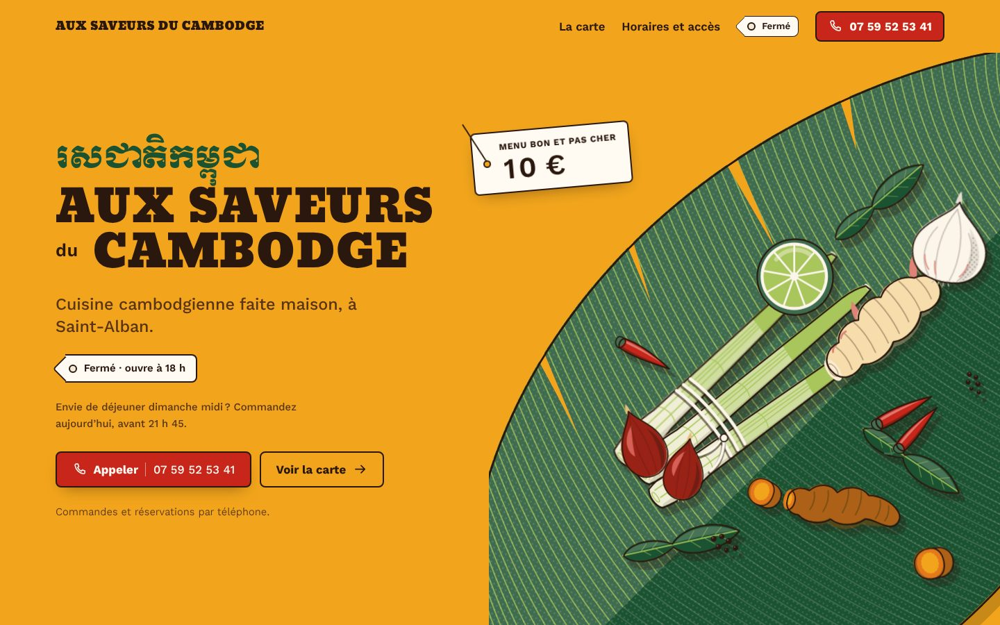
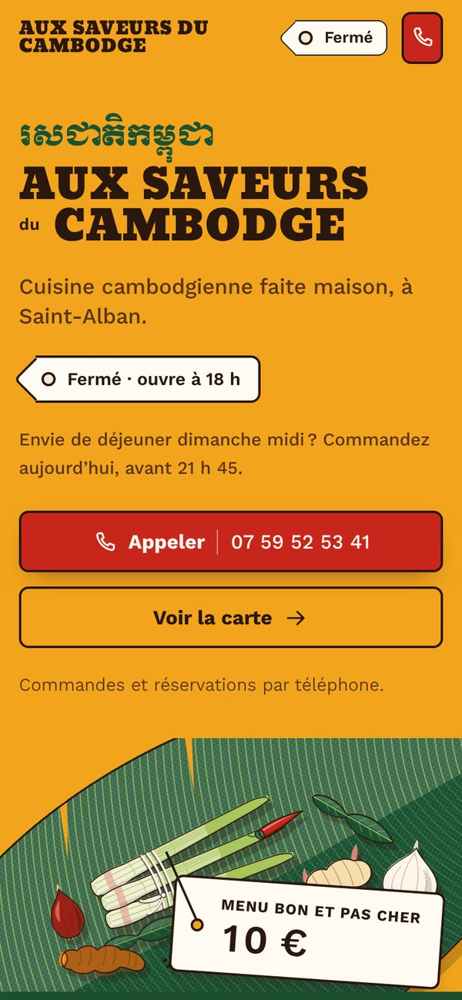
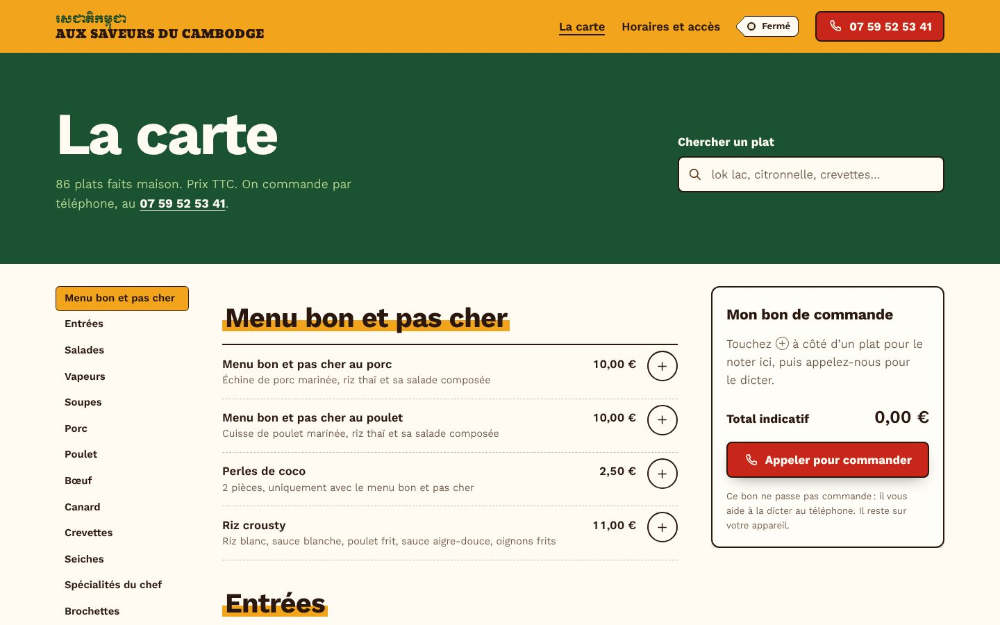

# Aux Saveurs du Cambodge — nouveau site

Refonte complète du site [auxsaveursducambodge-saintalban.com](https://www.auxsaveursducambodge-saintalban.com),
restaurant cambodgien du 10 avenue Salvador Allende, à Saint-Alban.



| Mobile | La carte |
|---|---|
|  |  |

Page d'accueil entière : [apercus/accueil-page-entiere.jpg](apercus/accueil-page-entiere.jpg).

## Ce qui change

| Avant (Squarespace) | Maintenant |
|---|---|
| Fond gris, aucune image, aucune identité | Un univers d'étal de marché : curcuma, feuille de bananier, ingrédients du kroeung dessinés pour le site, enseigne bilingue khmer/français |
| Bouton « Cammandez dès maintenant » qui renvoyait vers l'accueil | Bouton **Appeler** partout, barre d'actions fixe sur mobile (Appeler · La carte · Y aller) |
| Horaires en texte brut, avec fautes | Horaires en tableau, jour courant entouré, **état ouvert/fermé en direct** (heure de Paris), rappel « commandez la veille » pour le midi du week-end |
| Carte à l'adresse `/nouvelle-page`, 35 répétitions de la mention riz, prix « €7,5 € » | Carte à `/carte/` (l'ancienne adresse redirige), recherche instantanée, index des rubriques, prix au format « 7,50 € » alignés |
| — | **Bon de commande** : on coche ses plats, on voit le total, on appelle et on le dicte |
| Formulaire « Vous avez envie de travailler avec nous ? » (texte de modèle) | Adresse, plan du quartier dessiné d'après l'IGN, liens Itinéraire / Waze / Plans |
| Pas de description, pas de données pour Google | Titre et description, image de partage, données structurées `Restaurant` et `Menu` (horaires, adresse, prix), sitemap |
| — | Accessible (0 erreur axe-core, contrastes AA, clavier, lecteurs d'écran), sans cookie, sans traceur, ~80 Ko de polices auto-hébergées |

Toutes les coquilles corrigées et les points à confirmer sont listés dans [CORRECTIONS.md](CORRECTIONS.md).

## Avant la mise en ligne

1. **Mentions légales** : remplir `legal` dans `data/restaurant.json` (raison sociale, SIRET, directeur de la publication, hébergeur), puis reconstruire. C'est obligatoire pour un site professionnel (LCEN).
2. **Vérifier la carte** : les points du tableau « À faire vérifier » de [CORRECTIONS.md](CORRECTIONS.md), notamment les brochettes de crevettes affichées à deux prix.
3. **Faire relire le khmer** : « រសជាតិកម្ពុជា » (saveurs du Cambodge), « អរគុណ » (merci), « ឆ្ងាញ់ » (délicieux) et les noms d'ingrédients.
4. **Service sur place** : le site dit « Commandes et réservations par téléphone ». À corriger si le restaurant ne fait que de la vente à emporter.

## Modifier le site

Tout le contenu vient de deux fichiers :

- `data/restaurant.json` : nom, téléphone, adresse, horaires, fermetures exceptionnelles, mentions légales ;
- `data/carte.json` : rubriques, plats, descriptions, prix, plats mis en avant sur l'accueil (`"featured": 1` à `6`).

Puis, avec Node.js 18 ou plus récent, sans rien installer :

```sh
node build.mjs          # régénère les pages dans public/
npx serve public        # aperçu sur http://localhost:3000
```

Fermeture exceptionnelle (le bandeau d'état l'affichera) :

```json
"closures": [{ "from": "2026-12-24", "to": "2027-01-02", "label": "congés de fin d'année" }]
```

## Mettre en ligne

Le dossier `public/` est le site complet : du HTML, du CSS et un peu de JavaScript, sans serveur ni base de données.

- **Netlify** (le plus simple) : glisser le dossier `public/` sur [app.netlify.com/drop](https://app.netlify.com/drop).
  Avec le dépôt GitHub : dossier de base `aux-saveurs-du-cambodge`, le reste est dans `netlify.toml`.
- **Cloudflare Pages, Vercel** : commande `node build.mjs`, dossier de sortie `public`.
- **Hébergeur classique (OVH, o2switch…)** : envoyer le contenu de `public/` par FTP.

Pour garder l'adresse actuelle, il faut ensuite faire pointer le domaine vers le nouvel hébergeur
(enregistrements DNS chez le gestionnaire du domaine, éventuellement Squarespace Domains) et résilier l'abonnement Squarespace une fois la bascule faite.

`_redirects` (Netlify, Cloudflare) envoie l'ancienne adresse `/nouvelle-page` vers `/carte/` ; une page de redirection couvre les autres hébergeurs.

## Organisation

```
aux-saveurs-du-cambodge/
├── build.mjs              générateur, sans dépendance
├── data/                  contenu : restaurant.json, carte.json
├── src/svg/               illustrations générées par tools/etal.mjs
├── public/                site prêt à publier (pages générées + assets)
│   └── assets/            css, js, polices (OFL), plan du quartier
├── tools/                 régénération ponctuelle des polices, du plan, des dessins et des images
├── PRODUCT.md, DESIGN.md  contexte produit et système visuel (couleurs, typographie, règles)
└── CORRECTIONS.md         corrections de contenu et points à vérifier
```

Les outils de `tools/` ne servent que pour changer les dessins, les mots khmers, le plan ou l'image de partage :

| Outil | Rôle | Prérequis |
|---|---|---|
| `node tools/etal.mjs` | dessine les ingrédients et la feuille de bananier | Node |
| `python tools/fonts.py` | sous-ensembles des polices Kantumruy Pro et Moul | `pip install fonttools brotli` |
| `python tools/plan.py` | plan du quartier depuis la BD TOPO de l'IGN | `pip install fonttools brotli` |
| `node tools/images.mjs` | favicon, icônes, image de partage `og.jpg` | Playwright + Chromium |

## Crédits

- Illustrations : dessins vectoriels créés pour le site (ce ne sont pas des photos des plats).
- Plan : IGN – BD TOPO®, Licence Ouverte Etalab 2.0.
- Polices : Kantumruy Pro (Tep Sovichet, Wei Huang) et Moul (Danh Hong), SIL Open Font License 1.1 — voir `public/assets/fonts/OFL.txt`.
